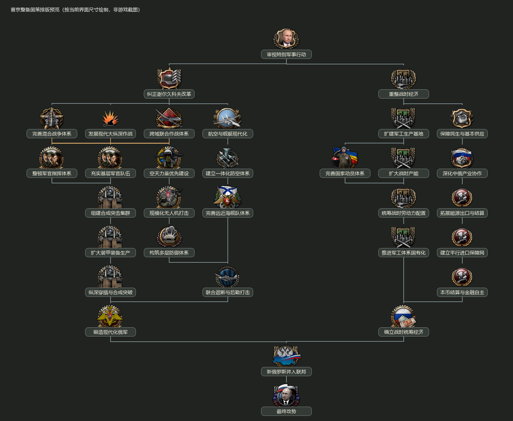

# 普京新国策：图标、经济奖励与测试说明（2026-10-25）

本次修正更新普京整备国策、奖励和前置关系。32 个国策的分支关系、纵向层级和耗时继续沿用原稿。三选一学说先解锁空天建设，随后解锁无人机国策。

## 图标与排版

此前套用的 TFR 图标宽 140–211 像素，高约 140–150 像素，而当前千禧黎明界面横向一格只有 96 像素，名称底板宽 165 像素，造成图标和标题互相挤压。
本版使用千禧黎明正常尺寸的陆海空、经济和普京图标（均不超过 100×100），并将横坐标按原稿统一乘以 2；上下层级、相对分支、前置和耗时保持。相邻节点现间隔 192 像素，名称底板之间至少有 27 像素空隙。没有修改其他国家的图标或全局国策界面。过长标题适度缩短以便阅读。
以下是按界面尺寸绘制的排版核对图，并非游戏截图。

## 五项工业总量

工厂产出 **+30%**、生产效率增长 **+10%**、生产效率上限 **+25%**、通用建造速度 **+20%**、军用工厂专项建造速度另加 **+20%**。这五项分配为集中给出的 +5% 或 +10%，其他国策不再逐项零碎重复增加。既有法律、科技和其他树的加成另算。建造军用工厂时，通用与专项两个建造字段可以同时起作用。
13 个经济与动员国策逐项追加到一个永久的“战时工业与动员体系”民族精神，奖励提示统一显示 +5%、+10% 等格式。完成标记用于重算已获得的效果，重复触发不会重复叠加。其他国策分别发展民生与农业、科研、贸易、燃油、资源、动员、转线效率、资源短缺保障和建筑槽位。

## 自动扩建工厂

参考 TFR 俄罗斯“小企业发展”循环任务（源版为每 200 天建成 2 座工厂），在本版改为独立的永久民族精神与自动投产周期：
| 国策 | 自动扩建效果 |
|---|---|
| 扩建军工生产基地 | 每 90 天建成 1 座军用工厂。 |
| 扩大战时产能 | 当前批次结束后，后续每 60 天建成 1 座军用工厂。 |
| 确立战时统筹经济 | 本周期到期即按新批次交付 1 座军用工厂和 1 座民用工厂，后续每 60 天一批。 |

三个阶段使用互相替换的民族精神，不会同时运行三份扩建。民族精神说明显示剩余天数及累计建成数量。工厂只在俄罗斯拥有且完全控制的本国核心地区投产，并增加相应建筑槽位，遵守当前 MD 的单州军工 35、民工 50 上限。暂时没有合适地区时保留订单，恢复条件后补建。读档和完成升级不会重置已在运行的批次。

## 每个国策的永久奖励

| 编号 | 国策 | 民族精神加成与机制 |
|---|---|---|
| 1 | 审视特别军事行动 | 计划速度 +20%；陆军组织度 +10%；指挥点增长 +25%；每月军事发展 +1%。 |
| 2 | 重整战时经济 | 工厂产出 +5%；生产效率上限 +5%；建造速度 +5%；税收收入 +5%。 |
| 3 | 纠正谢尔久科夫改革 | 陆军组织度 +10%；陆军防御 +10%；陆军训练时间 -15%；陆军经验增长 +25%；每月军事发展 +1%。 |
| 4 | 整顿军官指挥体系 | 陆军攻击 +10%；计划速度 +20%；最大计划加成 +10%；指挥点增长 +20%；增援率 +5%。 |
| 5 | 充实基层军官队伍 | 陆军组织度 +10%；组织度恢复 +15%；陆军训练时间 -15%；陆军经验增长 +25%；每月军事发展 +1%。 |
| 6 | 跨域联合作战体系 | 陆军攻击 +15%；突破 +20%；计划速度 +20%；空军任务效率 +15%；最大计划加成 +10%；每月军事发展 +1%。 |
| 7 | 航空与舰艇现代化 | 空军攻击 +15%；空军防御 +15%；海军伤害 +15%；海军防御 +15%；船坞产出 +20%；每月科研发展 +1%。 |
| 8 | 完善混合战争体系 | 陆军攻击 +15%；陆军防御 +15%；突破 +15%；陆军组织度 +10%；计划速度 +20%；每月军事发展 +1%。 |
| 9 | 发展现代大纵深作战 | 陆军攻击 +15%；突破 +25%；最大计划加成 +15%；陆军移动速度 +10%；计划速度 +15%；每月军事发展 +1%。 |
| 10 | 规模化无人机打击 | 陆军攻击 +15%；突破 +15%；对地攻击 +20%；空军任务效率 +15%；每月军事发展 +1%。 |
| 11 | 建立一体化防空体系 | 空军防御 +20%；空军拦截效率 +25%；制空任务效率 +15%；陆军防御 +10%；每月军事发展 +1%。 |
| 12 | 空天力量优先建设 | 空军攻击 +15%；空军任务效率 +15%；战斗中的制空优势加成 +20%；科研速度 +10%；每月科研发展 +2%。 |
| 13 | 构筑多层防御体系 | 陆军防御 +25%；最大堑壕 +5；堑壕速度 +30%；陆上要塞建造速度 +40%；组织度恢复 +10%。 |
| 14 | 扩大装甲装备生产 | 工厂产出 +10%；生产效率上限 +5%；军用工厂建造速度 +5%；装备改装速度 +20%。 |
| 15 | 组建合成突击集群 | 突破 +25%；陆军攻击 +15%；陆军移动速度 +10%；陆军组织度 +10%；增援率 +5%。 |
| 16 | 锻造现代化俄军 | 陆军攻击 +20%；陆军防御 +20%；突破 +20%；陆军组织度 +15%；组织度恢复 +15%；每月军事发展 +2%。 |
| 17 | 完善远近海舰队体系 | 海军伤害 +20%；海军防御 +20%；舰队协同 +20%；海军组织度恢复 +20%；船坞产出 +25%；每月军事发展 +1%。 |
| 18 | 联合遮断与后勤打击 | 陆军攻击 +15%；对地攻击 +25%；战略轰炸 +20%；海军伤害 +15%；计划速度 +20%；补给消耗 -10%。 |
| 19 | 纵深穿插与合成突破 | 突破 +30%；陆军攻击 +15%；陆军移动速度 +15%；最大计划加成 +15%；补给消耗 -10%。 |
| 20 | 扩建军工生产基地 | 建造速度 +5%；军用工厂建造速度 +10%。解锁军工扩建：每 90 天自动建成 1 座军用工厂。 |
| 21 | 统筹战时劳动力配置 | 生产效率增长 +5%；基础生产效率 +10%；转线效率保留 +10%；每月社会发展 +5%。 |
| 22 | 保障民生与基本供应 | 稳定度 +10%；消费品工厂系数 -5%；个人价值 +10%；每月减贫发展 +5%；每月农业发展 +5%。 |
| 23 | 深化中俄产业协作 | 生产效率上限 +5%；科研速度 +10%；每月科研发展 +5%；贸易评价 +10%。 |
| 24 | 拓展能源出口与结算 | 税收收入 +15%；资源开采效率 +10%；燃油获取 +10%；基础设施建造速度 +20%；化石燃料电厂建造速度 +20%。 |
| 25 | 完善国家动员体系 | 适役人口系数 +25%；适役人口 +5%；陆军训练时间 -20%；战争支持度 +15%；每月军事发展 +5%。 |
| 26 | 扩大战时产能 | 工厂产出 +10%；生产效率上限 +5%；军用工厂建造速度 +5%；每月工业发展 +5%。军工扩建从下一周期起缩短到每 60 天。 |
| 27 | 建立平行进口保障网 | 资源短缺生产惩罚 -20%；转线效率保留 +20%；基础生产效率 +20%；科研速度 +10%。 |
| 28 | 本币结算与金融自主 | 税收收入 +10%；商业价值 +10%；个人价值 +5%；政治点数增长 +10%。 |
| 29 | 推进军工体系国有化 | 工厂产出 +5%；生产效率上限 +5%；生产效率增长 +5%；建造速度 +5%。 |
| 30 | 确立战时统筹经济 | 建造速度 +5%；消费品工厂系数 -5%；建筑槽位 +10%。全面扩建：每批 1 座军用工厂和 1 座民用工厂，后续每 60 天一批。 |
| 31 | 新俄罗斯并入联邦 | 稳定度 +10%；适役人口系数 +15%；陆军组织度 +10%；基础设施建造速度 +25%；每月社会发展 +2%；每月减贫发展 +2%。 |
| 32 | 最终攻势 | 陆军攻击 +25%；突破 +30%；陆军组织度 +15%；计划速度 +30%；组织度恢复 +20%；补给消耗 -10%。 |

陆军安排攻防、突破、组织度、恢复与后勤；空军安排制空、拦截、对地支援和任务效率；海军安排伤害、防御、协同、恢复与船坞产出。三条军改学说各有侧重。

## 前置顺序修正

- 任一军改学说 → 空天力量优先建设 → 规模化无人机打击。
- 扩建军工生产基地 → 扩大战时产能；再与国家动员共同解锁劳动力调配 → 军工国有化。
- 中俄产业协作 → 能源出口与结算 → 平行进口保障网 → 本币结算与金融自主。
- 现代化俄军汇总同时要求“纵深穿插与合成突破”和“联合遮断与后勤打击”。
- 两侧建设完成后，才能推进新俄罗斯并入联邦 → 最终攻势。

每局选择三条互斥学说之一，其余项目均为通向最终攻势的必要前置，共 30 项、1001 天；不会再跳过中间项目。所有国策位置、耗时与奖励沿用本次图标经济调整版。

## 结尾与测试

倒数第二项“新俄罗斯并入联邦”：吞并仍存在且未与俄方交战的 NOV、DPR、LPR，接收其部队并取得三者的既有核心。最后一项“最终攻势”：清除全乌克兰、既定战区和残留地区的本版、旧版两种“未经计划的攻势”，保留北约介入与欧陆战争的既有接线。
退出并重启游戏。正在使用本树的旧存档，载入后至迟经过一天会按已完成的经济国策重算奖励；已完成扩建相关国策时自动补接扩建民族精神。此次补接不重置国策完成记录。
如需在独立测试存档快速载入本树，可使用 `event dsw_sov.20 SOV`。这个测试事件会重置当前国策进度。暂停后临时开启 `focus.autocomplete` 可以快速点国策，结束后再次输入关闭。
自动扩建可完成第 20 项后运行 90 天测试；第 26 项升级下一批周期，第 30 项增加民用工厂。可从民族精神提示查看倒计时和累计投产数。

已通过 1125 项国策、数值、图标、排版、本地化检查和 86 项战役逻辑模型检查；循环工厂的到期、升级、防重复、占领期间暂停交付、恢复后补建、读档迁移及单州上限已做离线模拟。尚未进入 HOI4 实机复测。

编辑稿国策采用 `common/national_focus/DSW_SOV_putin_preparation.txt`。
民族精神：`common/ideas/DSW_SOV_putin_preparation_spirits.txt`；周期工厂：`common/scripted_effects/DSW_SOV_industry_projects.txt`。
修改前备份保留在开发工作区，不纳入仓库。
